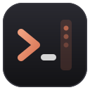
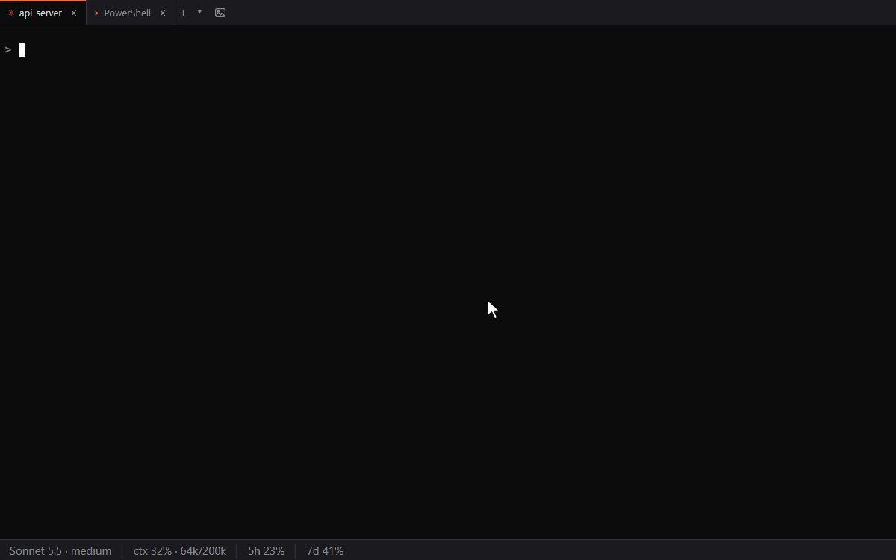
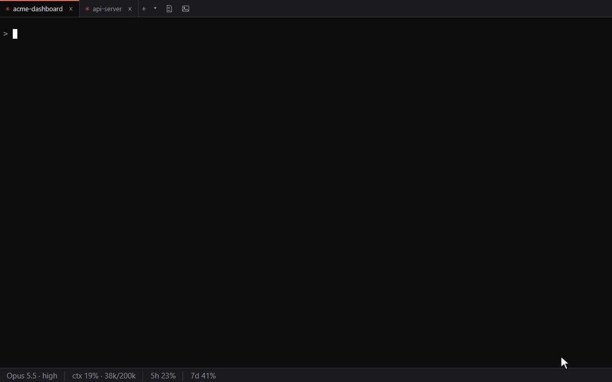
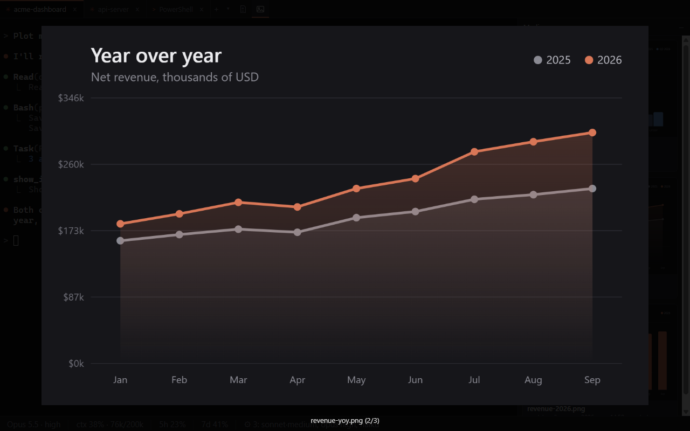
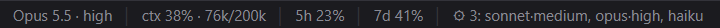
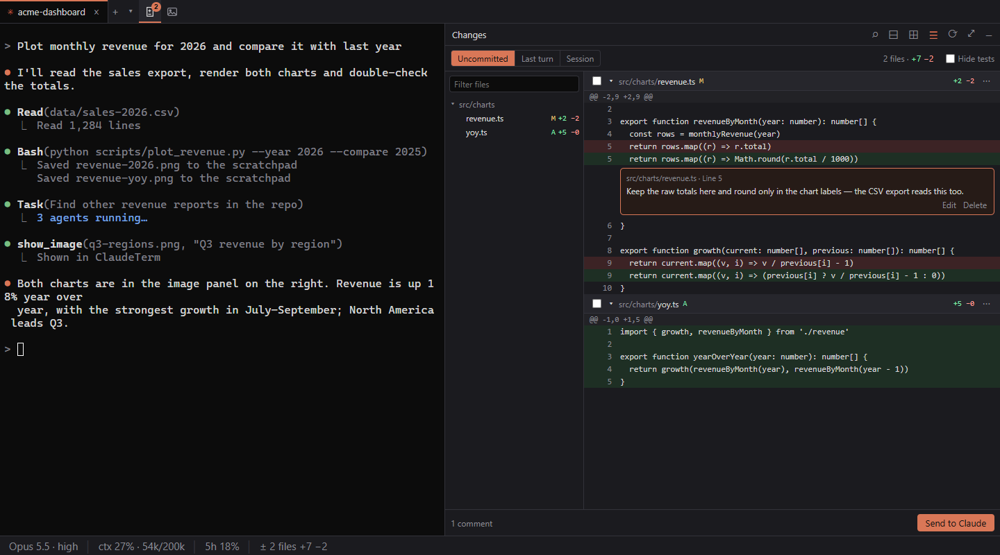
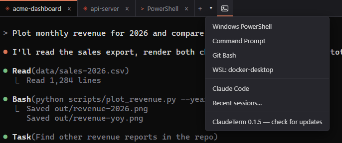
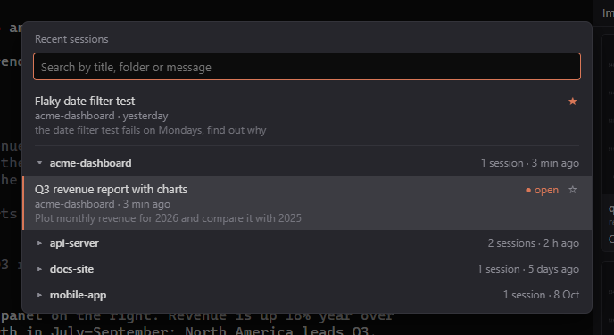
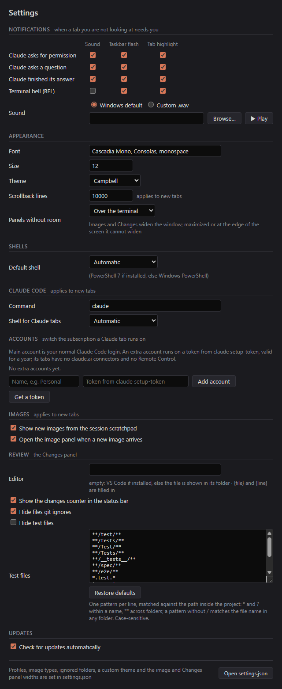
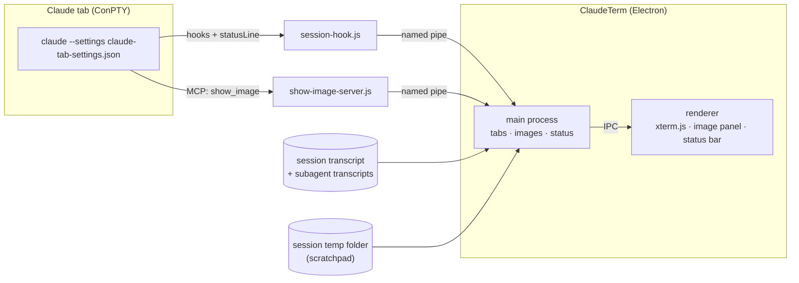

<p align="center">
  
</p>

<h1 align="center">ClaudeTerm</h1>

<p align="center">
  <b>A terminal built for Claude Code, on Windows, macOS and Linux.</b><br>
  Tabs for every shell, every image of the conversation in a side panel,<br>
  a live status bar for model, context, limits and subagents — and your sessions back after a reboot.
</p>

<p align="center">
  <a href="https://github.com/DmVergasov/ClaudeTerm/actions/workflows/ci.yml"></a>
  <a href="https://github.com/DmVergasov/ClaudeTerm/releases/latest"></a>
  
  <a href="LICENSE"></a>
</p>

<p align="center">
  <a href="https://github.com/DmVergasov/ClaudeTerm/releases/latest"><b>Download for Windows, macOS or Linux</b></a>
  ·
  <a href="#features">Features</a>
  ·
  <a href="#keyboard-shortcuts">Shortcuts</a>
  ·
  <a href="#settings">Settings</a>
  ·
  <a href="CHANGELOG.md">Changelog</a>
  ·
  <a href="CONTRIBUTING.md">Contributing</a>
</p>

<p align="center">
  
  <br>
  
  <br>
  <sub>Screenshots use demo data.</sub>
</p>

## Features

### 🖼️ Every image of the conversation, right next to it

Claude Code works with images all the time — browser screenshots, charts it plots, files it reads, pictures you paste. In a plain terminal you never see them. ClaudeTerm puts them in a panel beside each Claude tab, the way the Claude mobile app does:

- **From the conversation** — screenshots returned by tools and MCP servers, images Claude opens with `Read`, images you paste, including those of subagents. On `--resume` the panel fills with the conversation's history.
- **Its scratchpad** — new and changed images in the temp folder Claude Code gives each session. The project folder is not watched, so images that another session, a dev server or a test run writes there stay out of your panel; an image Claude saves in the project shows up once Claude opens it or shows it.
- **On request** — the bundled `show_image` MCP tool lets Claude put any image in front of you with a caption.

The panel opens beside the terminal, not in its place: the window widens by the panel's width, so the terminal and Claude Code's screen keep their size, and closing the panel gives the width back. The Changes panel opens the same way. A maximized window, or one with no room left on the screen, shows the panel over the right of the terminal, or narrows the terminal if you choose so in the settings.

Click a card to open it full-size (wheel to zoom, drag to pan, arrows to flip); right-click to open it in a viewer, reveal it in Explorer, copy the image or its path, or insert the path into the prompt.

<p align="center"></p>

### 📊 A status bar that answers "how much is left?"

Under every Claude tab: the current model and reasoning effort, how full the context window is, how much of the 5-hour and weekly usage limits is spent, and which subagents are running right now with their model and effort. Hover for exact token counts, when each limit resets, and a list of the agents with their tasks.

While Claude carries out a superpowers plan (`subagent-driven-development` or `executing-plans`), the status bar shows how far it has got — `3/7 · Save dialog and file writing` — and a click on it lists every task as done, current or still to come. It follows the plan's progress ledger and ends with ✓ when the plan is finished.

<p align="center"></p>

The limits are shown for Claude Pro and Max subscriptions, where Claude Code reports them.

### 🔔 Know when Claude is waiting for you

When Claude asks for a permission, asks you a question or finishes its turn while you are looking elsewhere, ClaudeTerm plays the system sound (on macOS Glass, on Linux the desktop's message sound, through `paplay`, `pw-play` or `aplay`), flashes its taskbar button (bounces its Dock icon on macOS) and marks the tab. Nothing happens while that tab is in front of you. In **Settings** each of these cases — and a terminal bell from any program — has its own sound, taskbar flash and tab highlight switches, and the sound can be your own `.wav`.

A turn that ends in an API error — a connection lost mid-response, a rate limit — counts as finished too, so a session never stops without a word. Claude Code itself leaves a response cut off mid-stream to you; with **Continue a response a dropped connection cut off** on, ClaudeTerm types Claude Code's own "resume where it stops" nudge into the tab a few seconds later instead of calling you: up to 3 times in a row, and never once you have typed into that tab during the turn.

### 🔍 Review Claude's changes next to the conversation

Press `Ctrl+Shift+D` — or click the **Changes** button (a page with + and −) in the tab bar or the changes counter in the status bar — to open **Changes** beside a Claude tab:

- **Uncommitted** — everything not committed yet, untracked files included. **Last turn** — what Claude changed in its latest turn with edits. **Session** — everything it changed in this conversation. Last turn and Session show the files inside the tab's folder (Claude's edits elsewhere are counted, not shown) and work without git too: ClaudeTerm keeps each file as it was right before Claude's first change.
- **Comment on lines** — hover a line and click **+**, or drag along the margin for several lines. **Send to Claude** writes all your comments as one message — file, line and the quoted code — and sends it. The diff updates while Claude works on them.
- **File tree** — the changed files by folder on the left of the diff: click a file to jump to it, type in **Filter files** to show only the files whose path holds the text, and fold or unfold every file at once with ⊟ and ⊞. ☰ hides the tree.
- **Viewed** folds the files you are done with; a file Claude changes again unfolds.
- **Hide tests** — the checkbox in the panel leaves test files out of every view and says how many it hid; which files count as tests is a list of patterns in the settings.
- **Find** — `Ctrl+F` finds text in the diff (and in the file names), highlights every match and steps through them with `Enter`.
- **Ask in words** — "show me the diff of the last three commits, only src/main": Claude opens it in the panel with the bundled `show_diff` tool.
- Right-click a line to open the file at that line in your editor (VS Code by default, or your own command in `review.editor`), or show it in Explorer from the file's ⋯ menu.

<p align="center"></p>

### 🗂️ A real terminal, with tabs

- **Shell profiles detected automatically** — PowerShell 7, Windows PowerShell, Command Prompt, Git Bash and every WSL distribution, plus your own profiles. On macOS and Linux: your login shell, bash, zsh and fish.
- **Claude tabs** — `claude` runs inside your shell of choice, and you stay in that shell when it exits.
- **Proper terminal behaviour** — ConPTY on Windows, a real PTY on macOS and Linux, GPU rendering via xterm.js, Unicode, clickable links, search, drag & drop of files, smart `Ctrl+C` / `Ctrl+V` (`⌘C` / `⌘V` on macOS; pasting an image hands it to Claude), `Shift+Enter` for a new line in the prompt.
- **Font sizes in points**, exactly like Windows Terminal — `12` looks the same in both.

<p align="center"></p>

### 📂 Open Claude Code here

Right-click any folder (or the background of a folder) in Explorer → **Open Claude Code here**. A Claude tab opens in the running ClaudeTerm window — or ClaudeTerm starts if it isn't running. On Windows 11 the item is under **Show more options**. Windows only; on Linux run `claudeterm --claude <folder>`, on macOS `/Applications/ClaudeTerm.app/Contents/MacOS/ClaudeTerm --claude <folder>`.

### 🔁 Continue previous sessions

Rebooted or closed the window? On the next start ClaudeTerm offers to reopen the same tabs, and **each Claude tab resumes its own conversation** (`claude --resume <session>`), even when several of them ran in the same folder or you used `/clear` in between.

**Recent sessions** (`Ctrl+Shift+H`, or **Recent sessions…** in the ▾ menu) lists your latest Claude Code conversations from every project — also ones started outside ClaudeTerm — with their titles, folders and last messages. Type to filter, Enter to continue one: ClaudeTerm opens a Claude tab in that folder with `claude --resume`, or switches to the tab that already has it. Click the ☆ of a session (or press `Ctrl+D`) to star it: starred sessions stay on top of the list, however old. **Star session** in a Claude tab's right-click menu stars that tab's conversation.

<p align="center"></p>

### 👥 More than one Claude subscription

Hit the 5-hour limit on one subscription, or keep work and personal apart? Add your other accounts in **Settings → Accounts** and move a Claude tab between them in one click: **Continue as …** in the tab's right-click menu, or a click on the account in the status bar, restarts Claude Code on the other account and **continues the same conversation**. **▾ → Claude Code — &lt;account&gt;** opens a new tab on an account, and a new Claude tab takes the account of the tab you are in. The window title names the extra account of the tab in front.

Your normal Claude Code login stays the **Main account**. An extra account is a token from `claude setup-token` (Pro, Max, Team or Enterprise, valid for a year): **Get a token** opens a tab that runs it — sign in with that account in the browser, then paste the token it prints. ClaudeTerm keeps the tokens encrypted by the system (DPAPI on Windows, the Keychain on macOS, the keyring on Linux) and gives each one only to the tabs on its account. Claude Code lets a token make model requests only, so a tab on an extra account has no claude.ai connectors and no Remote Control.

## Install

1. Install [Claude Code](https://docs.claude.com/en/docs/claude-code) so that `claude` is on your `PATH`.
2. Download `ClaudeTerm-Setup-<version>.exe` from the [latest release](https://github.com/DmVergasov/ClaudeTerm/releases/latest) and run it. It installs for the current user — no admin rights needed.

> [!NOTE]
> The installer is not code-signed yet, so Windows SmartScreen may warn about it: click **More info → Run anyway**.

**Linux (x64; Ubuntu 22.04+, Debian 12+ and their derivatives):** download `ClaudeTerm-<version>.deb` from the latest release and run `sudo apt install ./ClaudeTerm-<version>.deb`. ClaudeTerm downloads updates by itself; installing one asks for your password when you click restart. To paste images into Claude, Claude Code needs `xclip` (X11) or `wl-clipboard` (Wayland).

**macOS (12 or later, Apple Silicon or Intel):** download `ClaudeTerm-<version>-arm64.dmg` (Apple Silicon) or `ClaudeTerm-<version>-x64.dmg` (Intel) from the latest release, open it and drag ClaudeTerm to **Applications**.

> The app is not signed with an Apple Developer ID yet, so macOS refuses a downloaded copy the first time ("ClaudeTerm is damaged" or "cannot be verified"). Run this once in Terminal, then open ClaudeTerm as usual:
>
> ```
> xattr -dr com.apple.quarantine /Applications/ClaudeTerm.app
> ```
>
> Or try to open it once, then click **Open Anyway** in **System Settings → Privacy & Security**.

On macOS ClaudeTerm updates itself as well: it downloads a new release and puts it in place of the old one when you click **Restart**. Where it cannot replace itself — started from the disk image or not moved to Applications, or a folder you cannot write — the update banner's **Download** opens the release page instead.

From version 0.1.3 on, ClaudeTerm updates itself: it downloads a new release in the background and offers to restart into it, reopening your tabs and Claude conversations. **What's new** in the update banner lists what changed. Earlier versions need a one-time manual install. The ▾ menu next to the tabs has **ClaudeTerm <version> — check for updates** to check right away.

On its first start ClaudeTerm registers its `claudeterm` MCP server (the `show_image` and `show_diff` tools) with Claude Code at user scope. Uninstalling on Windows removes the Explorer menu item and the MCP registration. On Linux and macOS, remove the registration yourself after uninstalling (`sudo apt remove claudeterm`, or dragging ClaudeTerm out of Applications): `claude mcp remove --scope user claudeterm`.

**Requirements:** Windows 10 or 11 (x64), macOS 12 or later (Apple Silicon or Intel), or Ubuntu 22.04+ / Debian 12+ or a derivative (x64); and Claude Code (on Windows 2.1.139 or later).

## Keyboard shortcuts

| Action | Windows and Linux | macOS |
|---|---|---|
| New tab (default profile) | `Ctrl+Shift+T` | `⌘T` |
| New Claude tab in the current tab's folder | `Ctrl+Shift+L` | `⌘L` |
| Close tab | `Ctrl+Shift+W` | `⌘W` |
| Next / previous tab | `Ctrl+Tab` / `Ctrl+Shift+Tab` | `Ctrl+Tab` / `Ctrl+Shift+Tab`, `⌘⇧]` / `⌘⇧[` |
| Go to tab 1–9 | `Ctrl+Alt+1` … `Ctrl+Alt+9` | `⌘1` … `⌘9` |
| Copy / paste | `Ctrl+Shift+C` / `Ctrl+Shift+V` | `⌘C` / `⌘⇧V` |
| Copy selection, or interrupt when nothing is selected | `Ctrl+C` | — (`Ctrl+C` always interrupts) |
| Paste text, or hand a clipboard image to Claude | `Ctrl+V` | `⌘V` |
| New line in the Claude prompt | `Shift+Enter` | `Shift+Enter` |
| Find in scrollback | `Ctrl+Shift+F` | `⌘F` |
| Show / hide the image panel | `Ctrl+Shift+I` | `⌘I` |
| Show / hide the Changes panel | `Ctrl+Shift+D` | `⌘D` |
| Find in the Changes panel | `Ctrl+F` (when the panel has the focus) | `⌘F` (when the panel has the focus) |
| Recent sessions | `Ctrl+Shift+H` | `⌘⇧H` |
| Star / unstar the selected session | `Ctrl+D` (in the Recent sessions window) | `⌘D` (in the Recent sessions window) |
| Zoom in / out / reset | `Ctrl+=` / `Ctrl+-` / `Ctrl+0` | `⌘=` / `⌘-` / `⌘0` |
| Open settings | `Ctrl+,` | `⌘,` |

Right-click in the terminal copies the selection, or pastes when nothing is selected. On macOS `⌥`-drag selects text while Claude Code has the mouse (`Shift`-drag elsewhere). Double-click a tab to rename it.

Right-click a tab → **Restart session** restarts Claude Code in the same tab and resumes the conversation — handy after adding an MCP server, a plugin or a settings change that Claude Code only reads at startup. For a shell tab the item is **Restart shell**.

## Settings

Press `Ctrl+,` (or **▾ → Settings…**) to open the settings window: notifications, font, theme, shells, Claude Code, accounts, images and updates. Changes apply at once.



Everything is stored in `%APPDATA%\ClaudeTerm\settings.json` (`~/Library/Application Support/ClaudeTerm/settings.json` on macOS, `~/.config/ClaudeTerm/settings.json` on Linux). Profiles, image types, ignored folders, a custom theme and the image and Changes panel widths are set only there — the window's **Open settings.json** button opens it, and changes to the file apply as soon as you save it. When the window saves a change, it rewrites the file as plain JSON with two-space indentation.

```jsonc
{
  "defaultProfile": null,          // profile name; null = PowerShell 7 if installed, else Windows PowerShell (macOS, Linux: your login shell)
  "defaultFolder": null,           // the folder new tabs open in (a Claude tab: the folder of the tab it is opened from); null = your home folder
  "claude": {
    "command": "claude",           // how to start Claude Code
    "shellProfile": null,          // shell that hosts claude in Claude tabs; null = same rule as above
    "autoContinue": false          // type a nudge into a Claude tab whose response a dropped connection cut off, up to 3 times in a row
  },
  "profiles": [                    // added to (or overriding by name) the detected profiles
    { "name": "Git Bash", "command": "C:\\Program Files\\Git\\bin\\bash.exe", "args": ["--login", "-i"] }
  ],
  "font": { "family": "Cascadia Mono, Consolas, Menlo, monospace", "size": 12 },   // size in points
  "theme": "Campbell",             // "Campbell", "One Half Dark", "One Half Light", or an xterm.js theme object
  "scrollback": 10000,
  "imageWatch": {                  // new images in the session's scratchpad (Claude tabs only)
    "enabled": true,
    "extensions": ["png", "jpg", "jpeg", "gif", "webp", "bmp"],
    "ignore": [".git", "node_modules", "Intermediate", "DerivedDataCache", "Binaries", ".vs", ".idea"],
    "maxDepth": 8
  },
  "imagePanel": { "autoOpen": true, "width": 320, "maxItems": 200 },
  "notifications": {               // when a tab you are not looking at needs you
    "sound": "system",             // "system" or the full path to a .wav file
    "permission": { "sound": true,  "flash": true, "tab": true },   // Claude asks for a permission
    "question":   { "sound": true,  "flash": true, "tab": true },   // Claude asks a question
    "done":       { "sound": true,  "flash": true, "tab": true },   // Claude finished its turn
    "bell":       { "sound": false, "flash": true, "tab": true }    // a terminal bell (BEL) from any program
  },                               // flash: the taskbar button; tab: highlight the tab (a dot for the bell)
  "review": {                      // the Changes panel
    "editor": null,                // e.g. "code --goto {file}:{line}" or "rider64 --line {line} {file}"; null = VS Code if installed, else the file is shown in its folder
    "statusBar": true,             // the changes counter in the status bar
    "hideIgnored": true,           // hide files git ignores in Last turn and Session
    "hideTests": false,            // leave test files out of every view (the Hide tests checkbox in the panel)
    "testPatterns": ["**/tests/**", "*.test.*", "*Test.*"],  // which files are tests, matched against the path in the project (the default list is in the Settings window)
    "width": 640,                  // the panel's width when it opens, in px
    "fileTree": true,              // the file tree on the left of the diff (the ☰ button in the panel)
    "treeWidth": 200               // the file tree's width in px; dragging its right edge changes it until the next start
  },
  "sidePanel": { "noRoom": "overlay" },  // a maximized window, or one with no room to widen for Images or Changes: "overlay" lays the panel over the terminal, "narrow" narrows the terminal
  "autoUpdate": true               // check GitHub for new versions in the background
}
```

Logs are in `%APPDATA%\ClaudeTerm\logs` (`~/Library/Application Support/ClaudeTerm/logs` on macOS, `~/.config/ClaudeTerm/logs` on Linux).

### Good to know

- Claude tabs start `claude` with `--settings` pointing at a file ClaudeTerm generates. It adds `SessionStart`, `SubagentStart`, `SubagentStop`, `SessionEnd`, `PermissionRequest`, `UserPromptSubmit`, `PreToolUse` (for `AskUserQuestion` and the edit tools `Edit`, `MultiEdit`, `Write`, `NotebookEdit`) and `Stop` hooks and a `statusLine` command — that is how session restore, the image panel, the Changes panel, the status bar and the waiting signal know what is going on. These hooks never print anything, so they don't change what Claude does. Inside ClaudeTerm's Claude tabs this replaces a custom `statusLine` from your own Claude Code settings, and Claude Code hides its footer key hints.
- `claude` started by hand in a regular shell tab gets `show_image`, but not session restore, the transcript images or the status bar.
- Before Claude edits a file, ClaudeTerm keeps a copy of it in `%APPDATA%\ClaudeTerm\review` (`~/Library/Application Support/ClaudeTerm/review` on macOS, `~/.config/ClaudeTerm/review` on Linux), so Last turn and Session know the file before the edit; copies of a conversation untouched for a week are deleted.
- Extra accounts are kept in `%APPDATA%\ClaudeTerm\accounts.json` (`~/Library/Application Support/ClaudeTerm/accounts.json` on macOS, `~/.config/ClaudeTerm/accounts.json` on Linux), readable only by your user, with the tokens encrypted where the system has a keyring. A Claude tab on an extra account gets `CLAUDE_CODE_OAUTH_TOKEN`, and the `ANTHROPIC_API_KEY` and `ANTHROPIC_AUTH_TOKEN` of your environment are left out of it, because Claude Code would use them first.

## How it works



ClaudeTerm is an Electron app: `node-pty` runs the shells over ConPTY (a PTY on macOS and Linux) and xterm.js draws them. The hook script and the MCP server are small Node scripts run by the ClaudeTerm executable itself; they report to the app over a named pipe (a Unix socket on macOS and Linux), tagged with the tab they run in (`CLAUDETERM_TAB_ID`). Images and model details come from Claude Code's own transcript files, which ClaudeTerm tails read-only.

## Building from source

You need Windows 10/11, macOS or Linux, [Node.js](https://nodejs.org) 22.12 or later, and Git (on Linux also `build-essential` and `python3`: node-pty is compiled on install).

```powershell
git clone https://github.com/DmVergasov/ClaudeTerm.git
cd ClaudeTerm
npm ci
npm run dev          # run with hot reload (uses %APPDATA%\ClaudeTerm-dev, separate from an installed copy)
npm test             # unit and integration tests
npm run test:e2e     # end-to-end tests against the built app
npm run dist         # build the installer into dist\
npm run dist:linux   # build the .deb into dist/ (on Linux)
npm run dist:mac     # build the .dmg and .zip files into dist/ (on macOS)
```

See [CONTRIBUTING.md](CONTRIBUTING.md) for the project layout and how to get a change merged.

## Contributing

Bug reports, ideas and pull requests are welcome — please read [CONTRIBUTING.md](CONTRIBUTING.md) first. This project follows a [Code of Conduct](CODE_OF_CONDUCT.md). To report a security issue, see [SECURITY.md](SECURITY.md).

## License

[MIT](LICENSE) © Dmitry Vergasov

---

<sub>ClaudeTerm is an independent project and is not affiliated with, endorsed by, or sponsored by Anthropic. Claude and Claude Code are trademarks of Anthropic, PBC.</sub>
