<p align="center">
  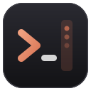
</p>

<h1 align="center">ClaudeTerm</h1>

<p align="center">
  <b>A terminal built for Claude Code, on Windows, macOS and Linux.</b><br>
  Tabs for every shell, every image of the conversation in a side panel,<br>
  usage limits in a title bar, a live status bar for model, context and subagents — and your sessions back after a reboot.
</p>

<p align="center">
  <a href="https://github.com/DmVergasov/ClaudeTerm/actions/workflows/ci.yml"></a>
  <a href="https://github.com/DmVergasov/ClaudeTerm/releases/latest"></a>
  
  <a href="LICENSE"></a>
</p>

<p align="center">
  <a href="https://github.com/DmVergasov/ClaudeTerm/releases/latest"><b>Download for Windows, macOS or Linux</b></a>
  ·
  <a href="#features">Features</a>
  ·
  <a href="#keyboard-shortcuts">Shortcuts</a>
  ·
  <a href="#settings">Settings</a>
  ·
  <a href="CHANGELOG.md">Changelog</a>
  ·
  <a href="CONTRIBUTING.md">Contributing</a>
</p>

<p align="center">
  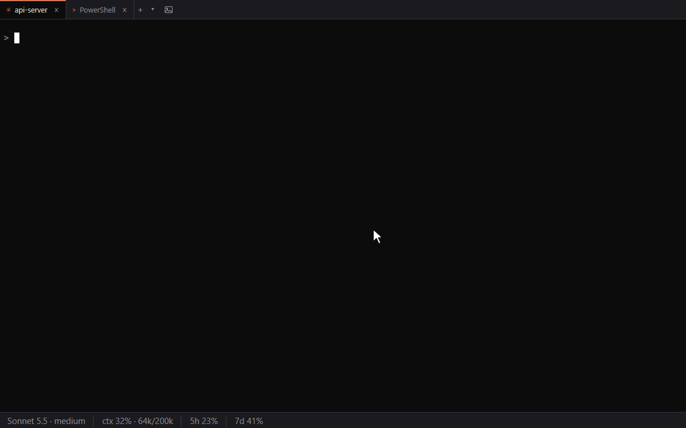
  <br>
  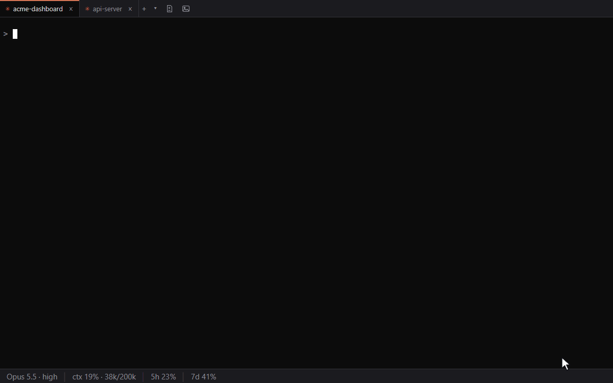
  <br>
  <sub>Screenshots use demo data.</sub>
</p>

## Features

### 🖼️ Every image of the conversation, right next to it

Claude Code works with images all the time — browser screenshots, charts it plots, files it reads, pictures you paste. In a plain terminal you never see them. ClaudeTerm puts them in the Media panel beside each Claude tab, the way the Claude mobile app does:

- **From the conversation** — screenshots returned by tools and MCP servers, images Claude opens with `Read`, images you paste, including those of subagents. On `--resume` the panel fills with the conversation's history.
- **Its scratchpad** — new and changed images in the temp folder Claude Code gives each session. The project folder is not watched, so images that another session, a dev server or a test run writes there stay out of your panel; an image Claude saves in the project shows up once Claude opens it or shows it.
- **On request** — the bundled `show_image` MCP tool lets Claude put any image in front of you with a caption.

The panel opens beside the terminal, not in its place: the window widens by the panel's width, so the terminal and Claude Code's screen keep their size, and closing the panel gives the width back. The Changes panel opens the same way. A maximized window, or one with no room left on the screen, shows the panel over the right of the terminal, or narrows the terminal if you choose so in the settings.

Click a card to open it full-size (wheel to zoom, drag to pan, arrows to flip); right-click to open it in a viewer, reveal it in Explorer, copy the image or its path, or insert the path into the prompt.

Audio and video files (`mp4`, `mov`, `webm`, `mkv`, `mp3`, `wav`, `m4a`, `ogg`) that Claude creates in its scratchpad or shows with `show_image` get a card too: a click opens the file in your system's player.

<p align="center">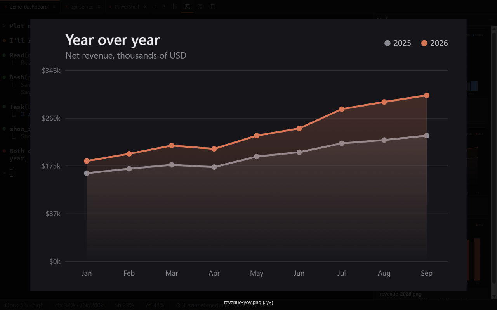</p>

### 📊 A status bar that answers "how much is left?"

Under every Claude tab: the current model with its reasoning effort as a small pill, how full the context window is with a small bar (measured against the auto-compact window when your settings set one, such as `"autoCompactWindow": 512000`, since that is where the conversation compacts), and which subagents are running right now with their model and effort. Hover for exact token counts and a list of the agents with their tasks.

The title bar across the top of the window holds the 5-hour and weekly usage limits in its middle, with the same kind of hover: when each limit resets. **Recent sessions** is with the tabs: at the bottom of the tabs on the left, in the ▾ menu of the tabs on top, and on `Ctrl+Shift+H` (`⇧⌘H` on macOS).

Each limit has a small bar: it fills with what is spent, and a mark on it shows how much of the limit's window has gone by, so a fill past the mark is a pace the limit will not last at. The color says where the pace leads: the accent for the five-hour limit and blue for the weekly one while the limit lasts until it resets, yellow when it would run out in the second half of the time left (or 90% is spent), red when sooner. Hover for when, at this pace, it runs out, or how much of it will be spent by the reset. To do without it, clear **Pace of the usage limits** in Settings → Claude Code: the limits then show the % alone, yellow from 70% and red from 90%.

When Claude ends its turn with work still running in the background — a shell command, a monitor, an agent it started there — the status bar says how many and what: `2 in background: build, tail -f server.log`. A long list is cut short; hover for each one's kind and command. Every turn end renews the list; it goes away once nothing runs any more, and with the session.

While Claude carries out a superpowers plan (`subagent-driven-development` or `executing-plans`), the status bar shows how far it has got — `3/7 · Save dialog and file writing` — and a click on it lists every task as done, current or still to come. It follows the plan's progress ledger and ends with ✓ when the plan is finished.

Claude can also keep a task list of its own, with the bundled `set_task_list` tool, when it sees fit or you ask. It shows the same way, in the same status bar segment and task box: a superpowers plan in progress comes first, and once the plan is done the list shows. The list stays with the conversation, through `/clear`, Restore and Recent sessions, and the task box's Clear removes it.

<p align="center">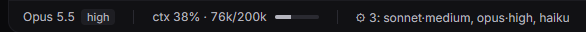</p>

The limits are shown for Claude Pro and Max subscriptions, where Claude Code reports them.

### 🔔 Know when Claude is waiting for you

When Claude asks for a permission, asks you a question or finishes its turn while you are looking elsewhere, ClaudeTerm plays the system sound (on macOS Glass, on Linux the desktop's message sound, through `paplay`, `pw-play` or `aplay`), flashes its taskbar button (bounces its Dock icon on macOS) and marks the tab. While the window is in the background it also shows a system notification with the tab's name: a click on it brings ClaudeTerm forward with that tab open, and opening the tab takes the notification away. Nothing happens while that tab is in front of you, unless you switch on **Even in front** for that case: then its sound plays there too. In **Settings** each of these cases — and a terminal bell from any program — has its own sound, taskbar flash, notification and tab highlight switches, and the sound can be your own `.wav`. The end of a turn that another Claude Code session started with a message is a case of its own as well, and it is off by default: switch it on to hear when such a turn finishes.

The app icon counts the tabs that need you: a number on the Dock icon (macOS) and the launcher (Linux), a dot over the taskbar button (Windows) with the number in its tooltip. `Ctrl+Shift+J` (`⌘J` on macOS) opens the next of them.

While Claude works in a tab, from your prompt to the end of its turn, the tab's ✳ spins through Claude Code's own spinner glyphs, on the tab bar, in the left panel and in the header of the tab in front, and a folded group spins too when Claude works in one of its tabs. It keeps spinning while an agent Claude started still works after the turn ends, since Claude Code waits for it and carries on when it reports. A tab where Claude waits for you shows a breathing badge instead; in the left panel its row names what for, in a word that breathes at the row's end — **Question** or **Permission**, or **Done** in green with a green dot for a finished answer — and its group shows a pulsing dot beside the number of its tabs. On the tab bar the badge of a finished answer breathes in green. The whole tab pulses softly with its badge or word, a faint tint that swells and fades, in green once Claude has answered; the tab in front never pulses. The ✳, ◐ or ◑ that Claude Code puts before its title is left out of the tab's name, since the icon shows the same.

Claude often ends a turn while work it started still runs in the background — subagents, background shell commands, monitors — and starts another turn when that work ends. Each of those turns is signalled as a finished answer; clear **Signal a finished answer during background work** in Settings → Notifications and only the turn after which nothing runs in the background is. ClaudeTerm learns about that work from Claude Code's `Stop` hook (`background_tasks`); a Claude Code that does not send it gets every turn signalled.

A turn that ends in an API error — a connection lost mid-response, a rate limit — counts as finished too, so a session never stops without a word. Claude Code itself leaves a response cut off mid-stream to you; with **Continue a cut-off response** on, ClaudeTerm types Claude Code's own "resume where it stops" nudge into the tab a few seconds later instead of calling you: up to 3 times in a row, and not when Claude Code's prompt in that tab holds text of yours: then the tab calls you as usual.

A tab you have not finished with gets the same breathing badge: **Mark as unread** in its right-click menu marks any tab (the one in front once you leave it). Turn on **Highlight a tab left unread** in Settings → Notifications, and a Claude tab you leave with Claude's reply not read to its end (Claude Code's *Jump to bottom* shows, or the terminal is scrolled back) or with an unsent prompt is marked by itself. Opening the tab clears the mark.

### 🔍 Review Claude's changes next to the conversation

Press `Ctrl+Shift+D` — or click the **Changes** button (a page with + and −) in the tab's header, or the changes counter in the status bar — to open **Changes** beside a Claude tab:

- **Uncommitted** — everything not committed yet, untracked files included. **Last turn** — what Claude changed in its latest turn with edits. **Session** — everything it changed in this conversation. Last turn and Session show the files inside the tab's folder (Claude's edits elsewhere are counted, not shown) and work without git too: ClaudeTerm keeps each file as it was right before Claude's first change.
- **Comment on lines** — hover a line and click **+**, or drag along the margin for several lines. **Send to Claude** writes all your comments as one message — file, line and the quoted code — and sends it. The diff updates while Claude works on them.
- **Lines around a change** — as on GitHub, ↑ over a hunk and ↓ under it show 20 more lines of the file, ↕ all of a short gap; two hunks with every line between them shown become one. These lines take comments too.
- **File tree** — the changed files by folder on the left of the diff: click a file to jump to it, type in **Filter files** to show only the files whose path holds the text, and fold or unfold every file at once with ⊟ and ⊞. ☰ hides the tree.
- **Viewed** folds the files you are done with; a file Claude changes again unfolds.
- **Hide tests** — the checkbox in the panel leaves test files out of every view and says how many it hid; which files count as tests is a list of patterns in the settings.
- **Markdown, formatted** — a `.md` file shows as the document it is, headings, lists, tables and code included: new and changed blocks have a green bar, removed ones stay where they were in red. Hover a block and click **+** to comment on it. Untick **Render Markdown** to see Markdown files as plain diffs.
- **Expand** — ⤢ spreads the panel over the sheet below its header; the title bar, the tabs and the header stay in view. ⤢ again or `Esc` puts it back.
- **Find** — `Ctrl+F` finds text in the diff (and in the file names), highlights every match and steps through them with `Enter`.
- **Ask in words** — "show me the diff of the last three commits, only src/main": Claude opens it in the panel with the bundled `show_diff` tool.
- Right-click a line to open the file at that line in your editor (VS Code by default, or your own command in `review.editor`), or show it in Explorer from the file's ⋯ menu.

<p align="center">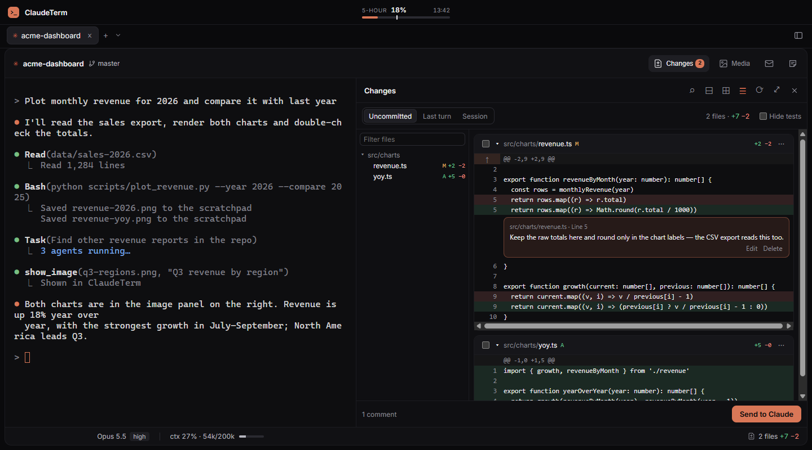</p>

### 📄 Documents Claude shows you

Ask Claude "show me the spec" and it opens the file in the **Docs** panel beside the terminal, with the bundled `show_document` tool. Claude can show a Markdown file, a PDF or an HTML report:

- **Markdown, formatted** — headings, lists, tables and code as the document they are. Hover a block and click **+** to comment on it; **Send to Claude** writes all your comments as one message, as in the Changes panel.
- **PDF** — in the built-in viewer, with its own zoom, pages and find. No comments.
- **HTML reports** — coverage and test reports, generated pages — in a sandboxed frame. Their scripts run in the frame, which cannot load anything from outside the report's folder, reach the window or navigate away. The scripts can read the files in that folder, so a report in your home folder or at a drive root is not shown.

The panel follows the file: when it changes, the document is drawn again. A Markdown document keeps your scroll position and comments; a PDF or HTML document reloads. Open or close Docs with the **Docs** button in the tab's header, with the other panel buttons (it shows once a Claude tab has a document), or `Ctrl+Shift+O` (`⌘O` on macOS).

### 🗂️ A real terminal, with tabs

- **Shell profiles detected automatically** — PowerShell 7, Windows PowerShell, Command Prompt, Git Bash and every WSL distribution, plus your own profiles. On macOS and Linux: your login shell, bash, zsh and fish.
- **Claude tabs** — `claude` runs inside your shell of choice, and you stay in that shell when it exits.
- **Notes** — a note of your own on each Claude tab, and one for each project. The Note button (or `Ctrl+Shift+N` / `⌘N`) opens a card over the terminal or the chat with a **Session | Project** switch: the session note stays with the conversation through `/clear`, a restart and Recent sessions; the project note is shared by every Claude tab of the same git project, its worktrees included, and stays on this device. **Checkbox** (or `[ ] ` typed at a line's start) makes a line a checkbox item, ticked with a click or `Ctrl+Enter`; **List** makes bullets. Drag the card's bottom-left corner to make it bigger. Collapsed, the note is a small label that counts the ticked items and shows the next one. Claude can read both notes, add to them and tick items with the bundled `read_notes`, `add_to_note` and `check_note_item` tools, never erasing your text; what is stored is plain Markdown (`- [ ] item`).
- **Proper terminal behaviour** — ConPTY on Windows, a real PTY on macOS and Linux, GPU rendering via xterm.js, Unicode, clickable links, search, drag & drop of files, smart `Ctrl+C` / `Ctrl+V` (`⌘C` / `⌘V` on macOS; pasting an image hands it to Claude), `Shift+Enter` for a new line in the prompt.
- **Font sizes in points**, exactly like Windows Terminal — `12` looks the same in both.
- **Tabs on the left** — **Tabs** in Settings → Appearance, or the position switch (in the tab bar, or at the bottom of the left column), moves the tabs into a column on the left, grouped by project (No project last), with the branch on every tab and a colored bar for a linked worktree. A **New tab** button sits at the top of the column, and **Recent sessions** at its bottom, over the account of the tab in front (the main account with its plan — Max, Pro, Team — as Claude Code's login names it, or the extra account it runs on), the bell for the notification settings, **Settings** and the position switch. The panel's buttons (Changes, Docs, Media, Note) stay in each tab's header. With the tabs on top, they are grouped by project too, under a label when there are several projects. Click a group's header to fold it; drag tabs or groups to reorder them, and `Ctrl+Tab` and `Ctrl+Alt+1` … `9` follow that order.
- **Fork session** — the right-click menu of a Claude tab with a conversation has **Fork session**: a new tab resumes that conversation from the same point, and in the left panel the fork is shown under its tab.

<p align="center">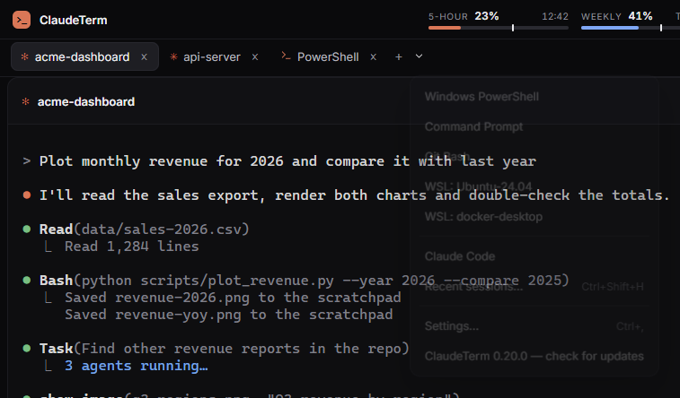</p>

### 💬 Chat

A Claude tab opens as a chat: your messages, Claude's answers with their Markdown (headings, lists, tables, code), and the work between them. Each batch of tool calls folds into one line, *Ran 3 tools · 2.5s*, and opens to show every call: the file an edit changed, a command with its output. A subagent has a line of its own with its state. Claude's questions and permission requests come as cards you answer right there: a number key or a click picks an option, Enter sends it, and Esc dismisses a question.

The switch in the tab's header moves the tab between the chat and Claude Code's own screen (**Terminal**). Settings → **Claude Code** → **Claude tabs open in** (Chat or Terminal) sets the view of the Claude tabs you open after the change; each tab keeps its own view and its switch.

Under the conversation is the composer. **Enter** sends, **Shift+Enter** starts a new line, and **Esc** stops the turn (a command waiting to open in the terminal or for `/resume` is dropped first); with nothing running it clears the draft. The paperclip attaches files and images, **@** adds a file of the project to the message, and the chips show how Claude may act (**Ask before edits**, **Accept edits**, **Plan**, and **Auto** when your account offers it; `Shift+Tab` goes to the next one), and the model chip picks the model and its effort. A message you send while Claude works waits for the turn to end.

Type `/` for Claude Code's commands. **/model** opens the model picker and **/resume** the Recent sessions window, both in the chat. A few commands need Claude Code's own screen — `/config`, `/permissions`, `/agents`, `/login`, `/doctor`, `/rewind` and others — and so does any line that starts with `!`: the tab switches to its terminal and the line is typed into Claude Code's prompt there, because the chat does not draw those dialogs and settings.

**/mcp** and **/plugin** (or the **MCP · Plugins** button in the tab's header) open a panel beside the chat with the session's MCP servers — their state, tools and errors; sign in, reconnect, turn off, remove, or add one by pasting a command, a URL or a JSON config — and your plugins and marketplaces. When the servers or plugins a chat would load change, whether from the panel or because Claude ran `claude mcp add`, the chat restarts its session once the answer has ended and goes on with the same conversation; other chats the change applies to offer **Restart**.

While Claude works, a side agent reads the conversation now and then (after every 6th tool call of a turn) and, when it finds something you would likely miss and should know — a decision Claude made in passing, a result that may be off, a concept the work depends on — shows it as a **Heads up** card above the message box. **Explain more** asks for a longer explanation, **Not relevant** keeps that topic from coming back, **Got it** closes the card. The side agent runs on Sonnet in the tab's account, with no tools and nothing kept in your sessions, and it uses your plan: **Heads up** in Settings → Claude Code turns it off.

A Claude tab on another of your computers shows its chat too, and you can send messages and answer its cards from there.

The chat runs on Anthropic's Claude Agent SDK (its license is in [THIRD-PARTY-NOTICES.md](THIRD-PARTY-NOTICES.md)) and needs **Claude Code 2.1.322 or later**. An older Claude Code, or one whose version cannot be read, opens the tab in the terminal as before. A folder Claude Code does not trust yet opens its Claude tab in the terminal for the trust dialog, whatever the setting.

<p align="center">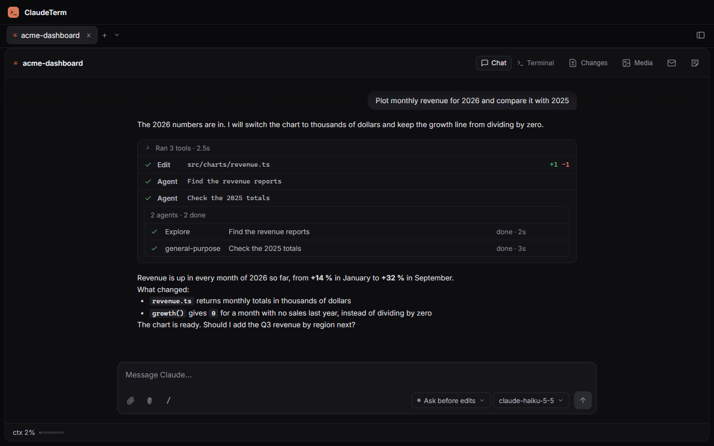</p>

<p align="center">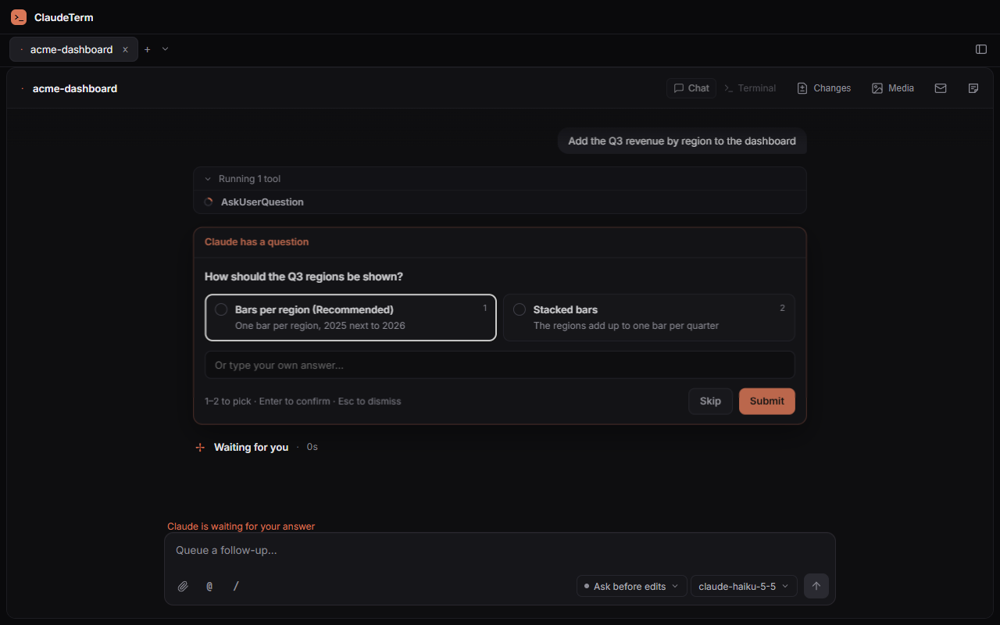</p>

### 📂 Open Claude Code here

Right-click any folder (or the background of a folder) in Explorer → **Open Claude Code here**. A Claude tab opens in the running ClaudeTerm window — or ClaudeTerm starts if it isn't running. On Windows 11 the item is under **Show more options**. Windows only; on Linux run `claudeterm --claude <folder>`, on macOS `/Applications/ClaudeTerm.app/Contents/MacOS/ClaudeTerm --claude <folder>`.

### 🔁 Continue previous sessions

Rebooted or closed the window? On the next start ClaudeTerm offers to reopen the same tabs, and **each Claude tab resumes its own conversation** (`claude --resume <session>`), even when several of them ran in the same folder or you used `/clear` in between.

A tab Claude was still working in when ClaudeTerm closed **goes on with that work by itself** once it is reopened: a few seconds after the conversation is back, ClaudeTerm asks Claude to resume where it stopped, unless you have typed something in that tab first. That includes a tab whose turn had ended while work Claude left in the background — agents, background commands — still ran: that work stopped with ClaudeTerm, so Claude is told so and asked to check what of it finished and go on. A turn you stopped yourself with Esc or Ctrl+C is not taken up again. **Go on after a restart** in **Settings → Claude Code** turns this off.

**Recent sessions** (`Ctrl+Shift+H`, or **Recent sessions…** in the ▾ menu) lists your latest Claude Code conversations from every project — also ones started outside ClaudeTerm — with their titles, folders and last messages. Type to filter, Enter to continue one: ClaudeTerm opens a Claude tab in that folder with `claude --resume`, or switches to the tab that already has it. Click the ☆ of a session (or press `Ctrl+D`) to star it: starred sessions stay on top of the list, however old. **Star session** in a Claude tab's right-click menu stars that tab's conversation.

<p align="center">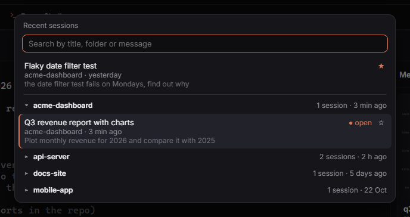</p>

### 👥 More than one Claude subscription

Hit the 5-hour limit on one subscription, or keep work and personal apart? Add your other accounts in **Settings → Accounts** and move a Claude tab between them in one click: **Continue as …** in the tab's right-click menu, or a click on the account in the status bar, restarts Claude Code on the other account and **continues the same conversation**. **▾ → Claude Code — &lt;account&gt;** opens a new tab on an account, and a new Claude tab takes the account of the tab you are in. The window title names the extra account of the tab in front.

Your normal Claude Code login stays the **Main account**. An extra account is a token from `claude setup-token` (Pro, Max, Team or Enterprise, valid for a year): **Get a token** opens a tab that runs it — sign in with that account in the browser, then paste the token it prints. ClaudeTerm keeps the tokens encrypted by the system (DPAPI on Windows, the Keychain on macOS, the keyring on Linux) and gives each one only to the tabs on its account. Claude Code lets a token make model requests only, so a tab on an extra account has no claude.ai connectors and no Remote Control.

### 🖥️ Devices: your other computers in one window

Pair ClaudeTerm on two or more computers, and each one shows the others' tabs in its own tab bar, under the device's chip. With the tabs on the left, they stand under the device's name, grouped by project with their branch, as your own do. In Settings → **Devices**, **Add a device** shows a code and this computer's addresses, valid for five minutes, and **Join a device** on the other computer takes one of the addresses and the code. The devices connect directly, over a network you set up yourself — a home network, Tailscale or a VPN. The first time ClaudeTerm accepts connections, Windows asks to allow it through the firewall, which needs an administrator; on macOS the system may ask to allow incoming connections. A device that the others cannot reach still connects to them, and Settings → **Devices** says **The other devices cannot connect to this one; to pair, show the code on the other device**.

A device's tabs can be typed into, closed, forked and given another folder (**Change folder…**, which this device's own tabs have too) from here, and a Claude tab on another device has its own status bar (the model, the context, the running agents and background tasks, the plan's progress and the changes counter), Media panel and Changes panel. Files pasted or dropped into one of its tabs are copied to that computer. Stars and session notes are the same on every device, and **Recent sessions** lists each device's conversations in a section of its own.

The computer stays awake while another device uses it: another device that types into one of its tabs, or has one of its Claude tabs open while that tab works, keeps it from sleeping (**Keep this computer awake while another device uses it** in Settings → **Devices**). Claude can read the state of your devices and their tabs with the `device_status` tool, and open Settings → **Devices** with `open_device_settings`, where you pair or remove devices yourself.

**Agent messages** let an agent in one Claude tab message an agent on another device, or on another Claude account, which Claude Code's own `ListAgents` and `SendMessage` cannot reach. Agents use `SendMessage` first, as they always have; only an agent that `ListAgents` does not show is reached through ClaudeTerm, with the `list_agents` and `message_agent` tools. A message wakes an idle agent when its Claude Code is 2.1.287 or later, and a busy agent reads it at its next step; an older Claude Code is listed as unable to receive messages.

The **Agent messages** button (in the tab's header, with the other panel buttons) opens the **Agent messages** panel: **This tab** shows the conversations of the tab in front, **All** every conversation on this device, newest first. It holds what agents write to each other with Claude Code's own `SendMessage` as well as through ClaudeTerm: ClaudeTerm reads those from the sessions' transcripts, shows a message between two of its tabs once, and names a session outside ClaudeTerm as Claude Code does. A tab with unread messages gets an envelope after its title, and so does a folded device chip or a device's header in the left panel; the button's badge counts the unread messages of the tab in front. Messages make no sound and no pop-up. In Settings → Panels → **Agent messages**, two options apply to each device on its own: **Let agents message tabs that Claude Code's own messaging can't reach** and **Mark tabs that got messages you haven't read**, both on by default.

## Install

1. Install [Claude Code](https://docs.claude.com/en/docs/claude-code) so that `claude` is on your `PATH`.
2. Download `ClaudeTerm-Setup-<version>.exe` from the [latest release](https://github.com/DmVergasov/ClaudeTerm/releases/latest) and run it. It installs for the current user — no admin rights needed.

> [!NOTE]
> The installer is not code-signed yet, so Windows SmartScreen may warn about it: click **More info → Run anyway**.

**Linux (x64; Ubuntu 22.04+, Debian 12+ and their derivatives):** download `ClaudeTerm-<version>.deb` from the latest release and run `sudo apt install ./ClaudeTerm-<version>.deb`. ClaudeTerm downloads updates by itself; installing one asks for your password when you click restart. To paste images into Claude, Claude Code needs `xclip` (X11) or `wl-clipboard` (Wayland).

**macOS (12 or later, Apple Silicon or Intel):** download `ClaudeTerm-<version>-arm64.dmg` (Apple Silicon) or `ClaudeTerm-<version>-x64.dmg` (Intel) from the latest release, open it and drag ClaudeTerm to **Applications**.

> The app is not signed with an Apple Developer ID yet, so macOS refuses a downloaded copy the first time ("ClaudeTerm is damaged" or "cannot be verified"). Run this once in Terminal, then open ClaudeTerm as usual:
>
> ```
> xattr -dr com.apple.quarantine /Applications/ClaudeTerm.app
> ```
>
> Or try to open it once, then click **Open Anyway** in **System Settings → Privacy & Security**.

On macOS ClaudeTerm updates itself as well: it downloads a new release and puts it in place of the old one when you click **Restart**. Where it cannot replace itself — started from the disk image or not moved to Applications, or a folder you cannot write — the update banner's **Download** opens the release page instead.

From version 0.1.3 on, ClaudeTerm updates itself: it downloads a new release in the background and offers to restart into it, reopening your tabs and Claude conversations. **What's new** in the update banner lists what changed. Earlier versions need a one-time manual install. The ▾ menu next to the tabs has **ClaudeTerm <version> — check for updates** to check right away.

On its first start ClaudeTerm registers its `claudeterm` MCP server (the `show_image`, `show_diff`, `show_document`, `set_task_list`, `get_task_list`, `device_status`, `open_device_settings`, `list_agents`, `message_agent`, `read_notes`, `add_to_note` and `check_note_item` tools) with Claude Code at user scope. Uninstalling on Windows removes the Explorer menu item and the MCP registration. On Linux and macOS, remove the registration yourself after uninstalling (`sudo apt remove claudeterm`, or dragging ClaudeTerm out of Applications): `claude mcp remove --scope user claudeterm`.

**Requirements:** Windows 10 or 11 (x64), macOS 12 or later (Apple Silicon or Intel), or Ubuntu 22.04+ / Debian 12+ or a derivative (x64); and Claude Code (on Windows 2.1.139 or later). The chat view needs Claude Code 2.1.322 or later; with an older one, Claude tabs open in the terminal.

## Keyboard shortcuts

| Action | Windows and Linux | macOS |
|---|---|---|
| New tab (default profile) | `Ctrl+Shift+T` | `⌘T` |
| New Claude tab in the current tab's folder | `Ctrl+Shift+L` | `⌘L` |
| Close tab | `Ctrl+Shift+W` | `⌘W` |
| Next / previous tab | `Ctrl+Tab` / `Ctrl+Shift+Tab` | `Ctrl+Tab` / `Ctrl+Shift+Tab`, `⌘⇧]` / `⌘⇧[` |
| Go to tab 1–9 | `Ctrl+Alt+1` … `Ctrl+Alt+9` | `⌘1` … `⌘9` |
| Copy / paste | `Ctrl+Shift+C` / `Ctrl+Shift+V` | `⌘C` / `⌘⇧V` |
| Copy selection, or interrupt when nothing is selected | `Ctrl+C` | — (`Ctrl+C` always interrupts) |
| Paste text, or hand a clipboard image to Claude | `Ctrl+V` | `⌘V` |
| New line in the Claude prompt | `Shift+Enter` | `Shift+Enter` |
| Find in scrollback | `Ctrl+Shift+F` | `⌘F` |
| Find in a chat | `Ctrl+F` or `Ctrl+Shift+F` | `⌘F` |
| Show / hide the Media panel | `Ctrl+Shift+I` | `⌘I` |
| Show / hide the Changes panel | `Ctrl+Shift+D` | `⌘D` |
| Show / hide the Docs panel | `Ctrl+Shift+O` | `⌘O` |
| Show / hide the note of a Claude tab | `Ctrl+Shift+N` | `⌘N` |
| Tick the checkbox item under the caret, in the note | `Ctrl+Enter` | `⌘Enter` |
| Next tab that needs you | `Ctrl+Shift+J` | `⌘J` |
| Find in the Changes panel | `Ctrl+F` (when the panel has the focus) | `⌘F` (when the panel has the focus) |
| Recent sessions | `Ctrl+Shift+H` | `⌘⇧H` |
| Star / unstar the selected session | `Ctrl+D` (in the Recent sessions window) | `⌘D` (in the Recent sessions window) |
| Zoom in / out / reset | `Ctrl+=` / `Ctrl+-` / `Ctrl+0` | `⌘=` / `⌘-` / `⌘0` |
| Open settings | `Ctrl+,` | `⌘,` |

Right-click in the terminal copies the selection, or pastes when nothing is selected. On macOS `⌥`-drag selects text while Claude Code has the mouse (`Shift`-drag elsewhere). Double-click a tab to rename it.

Right-click a tab → **Restart session** restarts Claude Code in the same tab and resumes the conversation — handy after adding an MCP server, a plugin or a settings change that Claude Code only reads at startup. A chat tab restarts by itself after such a change. For a shell tab the item is **Restart shell**. A Claude tab with a conversation also has **Fork session**, which opens a new tab that resumes a copy of that conversation from the same point.

## Settings

Press `Ctrl+,` (or **▾ → Settings…**) to open the settings window: tabs for General, Appearance, Claude Code, Notifications, Panels, Accounts and Devices, and a search field (`Ctrl+F`, `⌘F` on macOS) that finds a setting on any tab and lets you change it right there. Changes apply at once.

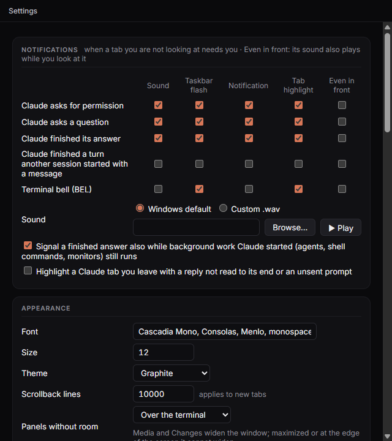

Everything is stored in `%APPDATA%\ClaudeTerm\settings.json` (`~/Library/Application Support/ClaudeTerm/settings.json` on macOS, `~/.config/ClaudeTerm/settings.json` on Linux). Profiles, image types, ignored folders, a custom theme and the image and Changes panel widths are set only there — the window's **Open settings.json** button opens it, and changes to the file apply as soon as you save it. When the window saves a change, it rewrites the file as plain JSON with two-space indentation.

```jsonc
{
  "defaultProfile": null,          // profile name; null = PowerShell 7 if installed, else Windows PowerShell (macOS, Linux: your login shell)
  "defaultFolder": null,           // the folder new tabs open in (a Claude tab: the folder of the tab it is opened from); null = your home folder
  "claude": {
    "command": "claude",           // how to start Claude Code
    "shellProfile": null,          // shell that hosts claude in Claude tabs; null = same rule as above
    "statusRefresh": true,         // refresh the status bar on a timer too; false = only with Claude Code's own updates (every message)
    "statusRefreshInterval": 5,    // that timer in seconds, 1–300; each refresh starts a few short processes per Claude tab
    "autoContinue": false,         // type a nudge into a Claude tab whose response a dropped connection cut off, up to 3 times in a row
    "continueAfterRestore": true,  // a restored tab Claude was working in when ClaudeTerm closed goes on by itself, also one whose background work it cut off
    "continueAfterLimit": true,    // a turn the usage limit stopped goes on by itself a minute after the limit resets; that limit's meter in the title bar counts down to it
    "headsUp": true,               // in a chat, a side agent on Sonnet shows what you should know above the message box while Claude works; it uses your plan
    "limitPace": true,             // each usage limit in the title bar has a bar, a color and a forecast from the pace it is spent at; false = the fixed 70% and 90% only
    "view": "chat"                 // Claude tabs open in the chat; "terminal" = Claude Code's own screen
  },
  "profiles": [                    // added to (or overriding by name) the detected profiles
    { "name": "Git Bash", "command": "C:\\Program Files\\Git\\bin\\bash.exe", "args": ["--login", "-i"] }
  ],
  "font": { "family": "Cascadia Mono, Consolas, Menlo, monospace", "size": 12 },   // size in points
  "theme": "Graphite",             // "Graphite" (the default), "Campbell", "One Half Dark", "One Half Light", or an xterm.js theme object
  "scrollback": 10000,
  "tabs": { "position": "top" },   // "top": the tab bar above the terminal; "left": a panel on the left, the tabs grouped by project
  "conpty": "bundled",             // Windows: the ConPTY new tabs run in; "bundled": Windows Terminal's, shipped with ClaudeTerm; "system": Windows' own
  "imageWatch": {                  // new images in the session's scratchpad (Claude tabs only)
    "enabled": true,
    "extensions": ["png", "jpg", "jpeg", "gif", "webp", "bmp"],
    "ignore": [".git", "node_modules", "Intermediate", "DerivedDataCache", "Binaries", ".vs", ".idea"],
    "maxDepth": 8
  },
  "imagePanel": { "autoOpen": true, "width": 320, "maxItems": 200 },
  "notifications": {               // when a tab you are not looking at needs you
    "sound": "system",             // "system" or the full path to a .wav file
    "doneWithBackgroundWork": true, // false: a turn that ends while background work Claude started still runs gives no signal (one that never ends, like a dev server, keeps every turn silent)
    "autoUnread": false,           // true: a Claude tab you leave mid-reply or with an unsent prompt shows the breathing badge until you open it
    "permission": { "sound": true,  "flash": true, "tab": true, "front": false },   // Claude asks for a permission
    "question":   { "sound": true,  "flash": true, "tab": true, "front": false },   // Claude asks a question
    "done":       { "sound": true,  "flash": true, "tab": true, "front": false },   // Claude finished its turn
    "peer":       { "sound": false, "flash": false, "tab": false, "front": false }, // Claude finished a turn another session started with a message (off by default)
    "bell":       { "sound": false, "flash": true, "tab": true, "front": false }    // a terminal bell (BEL) from any program
  },                               // flash: the taskbar button; tab: highlight the tab (a dot for the bell); front: the sound also while you look at the tab
  "review": {                      // the Changes panel
    "editor": null,                // e.g. "code --goto {file}:{line}" or "rider64 --line {line} {file}"; null = VS Code if installed, else the file is shown in its folder
    "statusBar": true,             // the changes counter in the status bar
    "hideIgnored": true,           // hide files git ignores in Last turn and Session
    "hideTests": false,            // leave test files out of every view (the Hide tests checkbox in the panel)
    "testPatterns": ["**/tests/**", "*.test.*", "*Test.*"],  // which files are tests, matched against the path in the project (the default list is in the Settings window)
    "width": 640,                  // the panel's width when it opens, in px
    "fileTree": true,              // the file tree on the left of the diff (the ☰ button in the panel)
    "treeWidth": 200,              // the file tree's width in px; dragging its right edge changes it until the next start
    "renderMarkdown": true         // show Markdown files formatted, not as plain diffs (the Render Markdown checkbox in the panel)
  },
  "agentMessages": {               // agent messages, in Settings → Panels → Agent messages; each device has its own
    "enabled": true,               // false: no messages in or out on this device, no mail watcher for its new Claude tabs, the Messages button hidden
    "marks": true                  // false: no envelope marks and no badge; the messages still flow and the panel still shows them
  },
  "sidePanel": { "noRoom": "overlay" },  // a maximized window, or one with no room to widen for Media or Changes: "overlay" lays the panel over the terminal, "narrow" narrows the terminal
  "autoUpdate": true               // check GitHub for new versions in the background
}
```

Logs are in `%APPDATA%\ClaudeTerm\logs` (`~/Library/Application Support/ClaudeTerm/logs` on macOS, `~/.config/ClaudeTerm/logs` on Linux).

### Good to know

- Claude tabs start `claude` with `--settings` pointing at a file ClaudeTerm generates. It adds `SessionStart`, `SubagentStart`, `SubagentStop`, `SessionEnd`, `PermissionRequest`, `UserPromptSubmit`, `PreToolUse` (for `AskUserQuestion` and the edit tools `Edit`, `MultiEdit`, `Write`, `NotebookEdit`) and `Stop` hooks and a `statusLine` command — that is how session restore, the Media panel, the Changes panel, the status bar and the waiting signal know what is going on. These hooks never print anything, so they don't change what Claude does. Inside ClaudeTerm's Claude tabs this replaces a custom `statusLine` from your own Claude Code settings, and Claude Code hides its footer key hints.
- `claude` started by hand in a regular shell tab gets `show_image`, but not session restore, the transcript images or the status bar.
- Before Claude edits a file, ClaudeTerm keeps a copy of it in `%APPDATA%\ClaudeTerm\review` (`~/Library/Application Support/ClaudeTerm/review` on macOS, `~/.config/ClaudeTerm/review` on Linux), so Last turn and Session know the file before the edit; copies of a conversation untouched for a week are deleted.
- Extra accounts are kept in `%APPDATA%\ClaudeTerm\accounts.json` (`~/Library/Application Support/ClaudeTerm/accounts.json` on macOS, `~/.config/ClaudeTerm/accounts.json` on Linux), readable only by your user, with the tokens encrypted where the system has a keyring. A Claude tab on an extra account gets `CLAUDE_CODE_OAUTH_TOKEN`, and the `ANTHROPIC_API_KEY` and `ANTHROPIC_AUTH_TOKEN` of your environment are left out of it, because Claude Code would use them first.

## How it works

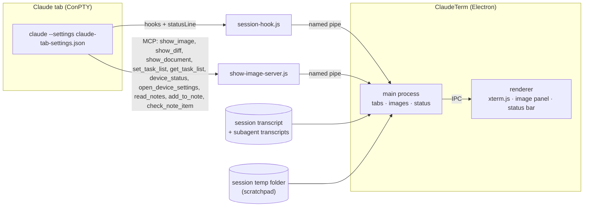

ClaudeTerm is an Electron app: `node-pty` runs the shells over ConPTY (a PTY on macOS and Linux) and xterm.js draws them. The hook script and the MCP server are small Node scripts run by the ClaudeTerm executable itself; they report to the app over a named pipe (a Unix socket on macOS and Linux), tagged with the tab they run in (`CLAUDETERM_TAB_ID`). Images and model details come from Claude Code's own transcript files, which ClaudeTerm tails read-only.

## Building from source

You need Windows 10/11, macOS or Linux, [Node.js](https://nodejs.org) 22.12 or later, and Git (on Linux also `build-essential` and `python3`: node-pty is compiled on install).

```powershell
git clone https://github.com/DmVergasov/ClaudeTerm.git
cd ClaudeTerm
npm ci
npm run dev          # run with hot reload (uses %APPDATA%\ClaudeTerm-dev, separate from an installed copy)
npm test             # unit and integration tests
npm run test:e2e     # end-to-end tests against the built app
npm run dist         # build the installer into dist\
npm run dist:linux   # build the .deb into dist/ (on Linux)
npm run dist:mac     # build the .dmg and .zip files into dist/ (on macOS)
```

See [CONTRIBUTING.md](CONTRIBUTING.md) for the project layout and how to get a change merged.

## Contributing

Bug reports, ideas and pull requests are welcome — please read [CONTRIBUTING.md](CONTRIBUTING.md) first. This project follows a [Code of Conduct](CODE_OF_CONDUCT.md). To report a security issue, see [SECURITY.md](SECURITY.md).

## License

[MIT](LICENSE) © Dmitry Vergasov

The bundled Inter font and Lucide icons carry their own licenses, listed in [THIRD-PARTY-NOTICES.md](THIRD-PARTY-NOTICES.md).

---

<sub>ClaudeTerm is an independent project and is not affiliated with, endorsed by, or sponsored by Anthropic. Claude and Claude Code are trademarks of Anthropic, PBC.</sub>
